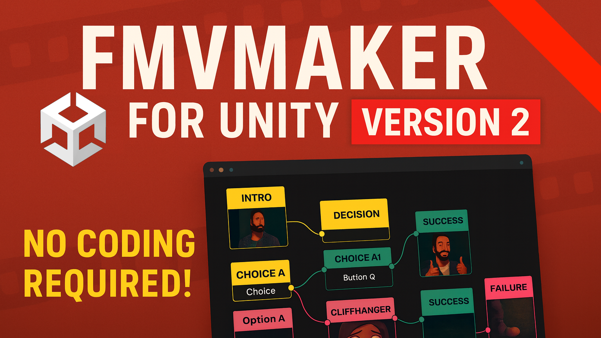

# FmvMaker

**Welcome to FmvMaker v2**

This branch introduces a completely new, node-based workflow for creating FMV games in Unity. It replaces the old JSON/Visual Scripting system with a custom **Graph Editor** based on Unitys [**Graph Toolkit**](https://docs.unity.com/en-us/engine/6000.6/manual/extending-the-editor/gtk-index), making it easier to visualize and build your game logic without writing code. You can find it in the Unity AssetStore as well: [FmvMaker-AssetStore Link](https://assetstore.unity.com/packages/tools/video/fmvmaker-182868)

**Requires Unity 6.6 (6000.6) or newer.**

---

## 📖 Quick Start Manual

Follow these simple steps to create your first FMV sequence, based on the [Sneak Peek Video](https://www.youtube.com/watch?v=Br4n8lIhe0A).

### 1. Setup Your Videos
* Import your video files into Unity.
* Place them in a valid folder (e.g., `Assets/FmvMaker/Videos` or any folder you prefer).

### 2. Create a Graph
* Right-click in the Project window.
* Select **Create > FmvMaker > FmvMaker Graph**.
* Name your graph (e.g., `NewGameGraph`).
* Double-click the asset to open the **Graph Editor**.

### 3. Build Your Flow
* **Add Nodes:** Right-click or press `Spacebar` in the editor to add nodes.
* **Start Node:** Always begin with a `Start FMV Node`. A graph needs exactly one.
* **End Node:** Connect the last video of a path to an `End FMV Node` to finish the game there.
* **Play a Video:**
	* Add a `Video Node`.
	* Connect the `Start Node` output to the `Video Node` input.
	* **Select Video:** Click the `Video Node`. In the Graph Inspector (right side), assign your video clip to the `Video Clip` field.
* **Create Choices:**
	* Add a `Video Context Node` (this acts as a hub for choices).
	* Click "Add Block" in the node to create multiple outputs (Choice 1, Choice 2, etc.).
	* You can set a label text and label text color for each choice, if that fits your game.
	* Leave the text empty, if you don't want to show the choices to the player.
	* Connect each output to different `Video Nodes`.
	* **Position Buttons:** In the Inspector, adjust `Relative Position (0-1)` and `Relative Size (0-1)` to place the click zones on screen. `0,0` is the lower left corner, `1,1` the upper right corner.
* **Create Choices with Timing:**
	* Add a `Video Context Time Node` (this acts as a hub for timed choices, like quick time events).
	* Click "Add Block" in the node to create multiple outputs (Choice 1, Choice 2, etc.).
	* You can set a label text and label text color for each choice, if that fits your game.
	* Leave the text empty, if you don't want to show the choices to the player.
	* Connect each output to different `Video Nodes`.
	* Connect the node output to a new `Video Node` input. This will be the default choice, when the time is up and the player didn't choose an option.
	* **Position Buttons:** In the Inspector, adjust `Relative Position (0-1)` and `Relative Size (0-1)` to place the click zones on screen.
* **Create Random Outcomes:**
	* Add a `Video Randomizer Node` (this picks one of its outcomes at random, e.g. the opponent's move in rock paper scissors).
	* Click "Add Block" in the node to create one `Random Outcome Block` per possible outcome.
	* Connect each outcome output to a different `Video Node`.
	* Set the `Weight` of each outcome. Weights are relative, so equal weights split the chance evenly (the default is 1, so 3 outcomes get 33% each). With weights 2/1/1 the outcomes get 50%/25%/25%. A weight of 0 disables an outcome.
	* The resulting chance is shown next to each outcome output, so you don't have to calculate it yourself.
	* The randomizer doesn't play a video itself. It picks an outcome right away and continues there.
	* Outcomes the player can't reach (because of a missing "Needed Item") are skipped and the chance is split between the remaining ones.

### 4. Run the Game
* Open the `FmvMakerSampleScene` scene (or duplicate it and build your own scene).
* Select the `FmvVideo` GameObject (a child of `FmvMaker`).
* Locate the `FmvVideos` component in the Inspector.
* Drag your `NewGameGraph` asset into the `Runtime Graph` field.
* Press **Play** in Unity!

---

---

## 🚀 Key Features

* **Native Graph Editor:** No more JSON editing. Visualize your entire game flow in a dedicated window.
* **Integrated Inventory:**
	* Create items via **Create > FmvMaker > InventoryItem**.
	* **Unlock Paths:** Set "Needed Item" on a video node to restrict access until the player has the specific item.
	* **Reward Players:** Set "Giving Items" on a node to add items to the inventory upon watching.
* **Random Outcomes:** Let the game decide with the `Video Randomizer Node` and weighted outcomes.
* **Portals:** Create clean loops (e.g., returning to a dialogue menu) without messy wires crossing the screen.
* **Save/Load System:** Built-in support to save inventory state and progress automatically.
* **Graph Validation:** Mistakes are marked directly on the nodes while you edit and listed in the Console. For example:
	* a missing or unconnected `Start FMV Node`
	* video nodes without a `Video Clip`
	* nodes that can never be reached
	* outputs that end the game unintentionally
	* choices or random outcomes without a connection
	* buttons positioned outside the screen
* **Live Play Mode Visualization:** Keep the Graph Editor open while you play to follow the game in the graph:
	* The playing node and the wire that led to it are animated and labeled "now playing".
	* Visited nodes get a full accent bar and show how often they were visited.
	* The taken path is drawn thick, all other wires are dimmed.
	* Random outcomes show their chance and how often they were picked.
	* The visualization is editor-only and isn't saved to your graph or included in builds.

---

## 🆚 Advantages Over Version 1

| Feature | Version 1 (Legacy) | **Version 2 (Graph Tool)** |
| :--- | :--- | :--- |
| **Workflow** | Manual JSON text files | **Visual Drag-and-Drop Editor** |
| **Setup Time** | High (prone to syntax errors) | **Instant (Plug & Play)** |
| **Logic** | Generic State Machine | **Dedicated FMV Logic Nodes** |
| **Conditionals** | Hard to implement | **Built-in Item Checks** |
| **Inventory** | Basic / External | **Native & Integrated into Graph** |
| **Error Checking** | At runtime | **While editing, marked on the nodes** |
| **Debugging** | Console logs | **Live path visualization in the graph** |

---

## 🤝 Support & Contribution

If you find this tool useful or want to support its development:
* **Feedback:** Open an issue on this repository.
* **Sponsor:** Support the developer on [GitHub Sponsors](https://github.com/sponsors/FireDragonGameStudio) or [Patreon](https://patreon.com/WaveLabs).
* **Community:** Join the discussion in the comments of the [Preview Video](https://www.youtube.com/watch?v=Br4n8lIhe0A).

Happy Creating!
